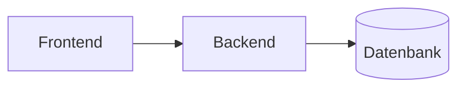

# Hackathon-README

## Zweck

Die Jury öffnet das Repo, liest zehn Sekunden und entscheidet, ob das Projekt ernst zu nehmen
ist. Diese README beantwortet in dieser Zeit: Was ist das, wie sieht es aus, wie startet man
es. Und die Startanleitung funktioniert tatsächlich.

## Wann nutzen – und wann nicht

**Nutzen:** vor der Abgabe; oder früh, wenn das Repo öffentlich ist und das Team einen
Einstieg braucht (Skelett kommt aus `hack-scaffold`).

**Nicht nutzen:** für Vault-Notizen (→ `obsidian-documentation`), den Devpost-Text
(→ `devpost-writer`), oder READMEs ausserhalb eines Hackathons.

## Vorgehen

1. **Bestand lesen.** Bestehende README, `package.json`-Scripts bzw. `Makefile`,
   `docker-compose.yml`, `pyproject.toml`, `.env.example`, `LICENSE`, Ordnerstruktur,
   Versionsdateien (`.nvmrc`, `.python-version`, `engines`). Eine bestehende README wird
   überarbeitet, nicht ersetzt: nichts Inhaltliches still streichen.
2. **Nur Fehlendes fragen** (höchstens drei Fragen): Einzeiler, Teamnamen und gewünschte
   Links, Lizenz. Fehlt eine `LICENSE`, MIT vorschlagen und fragen. Event-Regeln können eine
   bestimmte Lizenz verlangen.
3. **Setup ableiten.** Voraussetzungen mit Versionen, dann höchstens fünf Schritte: klonen,
   `.env` anlegen, installieren, (seeden), starten. Jeder Befehl muss im Repo existieren
   (Script, Datei, Compose-Service). Mehr als fünf Schritte heisst: Startbefehl im Repo
   vereinfachen und das vorschlagen, nicht die README aufblähen.
4. **Setup prüfen.**
   - Statisch, immer: Jeder genannte Befehl, jede Datei, jeder Port existiert bzw. passt zur
     Config.
   - Ausgeführt, nur nach Rückfrage: frischer Clone in einem Wegwerf-Ordner, Schritte genau
     wie in der README.
   - Im Ergebnis angeben, welche Prüfung gelaufen ist.
5. **Env-Variablen.** Tabelle aus `.env.example`, abgeglichen mit dem Code (z. B.
   `process.env.*`, `os.environ`). Spalten: Name, Zweck, Pflicht, woher. **Nie Werte.**
   Variablen, die der Code nutzt, die aber in `.env.example` fehlen, melden.
6. **Architektur.** Mermaid-`flowchart` mit 3–6 Knoten, die den tatsächlichen Komponenten
   entsprechen (GitHub rendert Mermaid). ASCII nur, wenn die Zielplattform kein Mermaid kann.
7. **Screenshot.** Platzhalter `` mit Hinweis, welcher
   Bildschirm sich am besten eignet. Kein Fake-Bild erzeugen.
8. **Schreiben und zeigen.** Bei einer bestehenden README den Diff zeigen und erst nach
   Zustimmung überschreiben.

## Ausgabeformat

````markdown
# ‹Projekt›
‹Einzeiler: was es tut, für wen›


## Features
- …

## Architektur


## Setup
Voraussetzungen: ‹Tool› ‹Version›
1. `git clone ‹url› && cd ‹ordner›`
2. `cp .env.example .env` und Werte eintragen (siehe unten)
3. `‹install›`
4. `‹start›` → http://localhost:‹port›

## Env-Variablen
| Name | Zweck | Pflicht | Woher |
|---|---|---|---|

## Team
- ‹Name› – ‹Rolle›

## Lizenz
‹Lizenz›
````

Darunter, nicht in der README: `Setup geprüft: statisch | ausgeführt`, offene Punkte.

## Grenzen

- Überschreibt keine bestehende README ohne gezeigten Diff und Zustimmung.
- Keine Secrets, keine echten Env-Werte, keine privaten Kontaktdaten ohne Zustimmung.
- Beschreibt nur Features, die im Code existieren. Geplantes kommt höchstens unter "Roadmap"
  und ist als geplant markiert.
- Committet nicht. Dafür gilt `git-branch-pr-workflow`.
